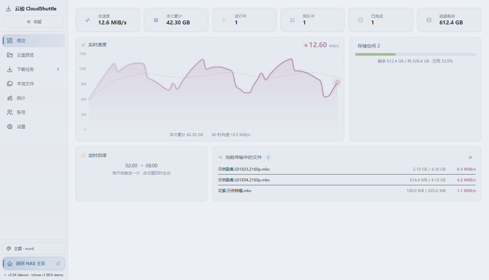
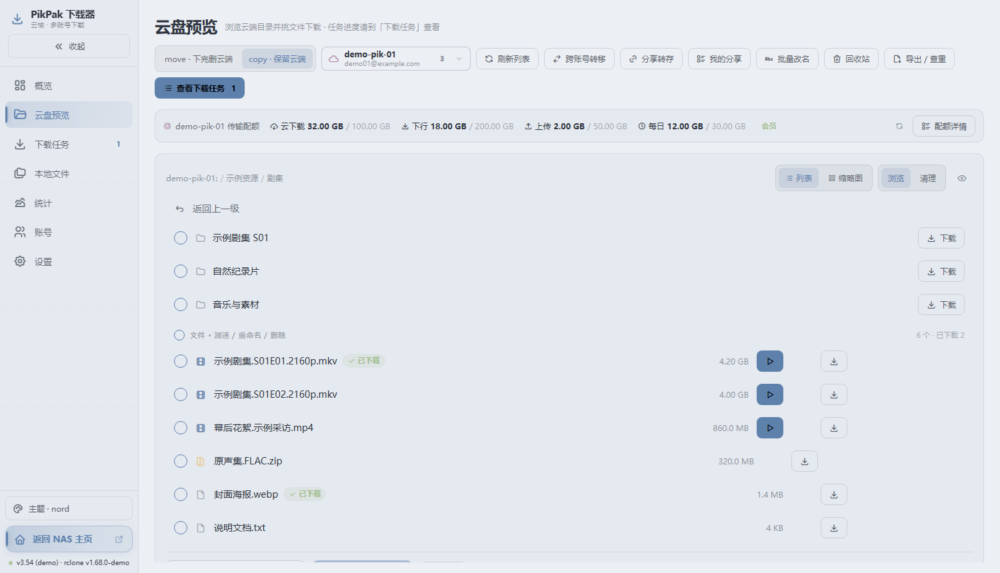
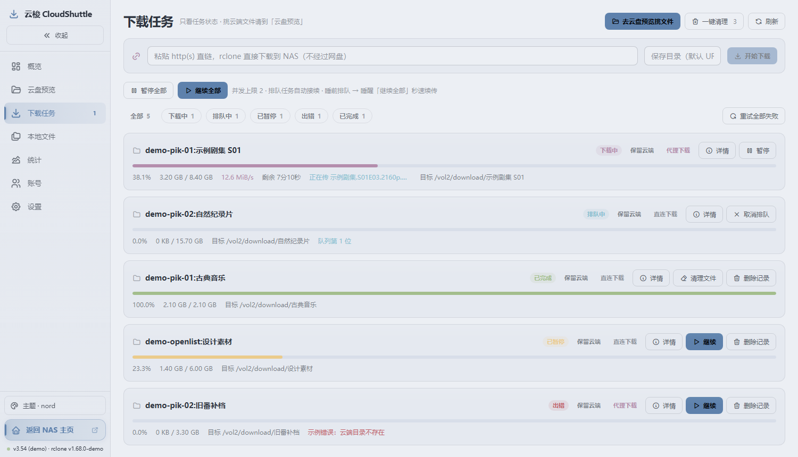
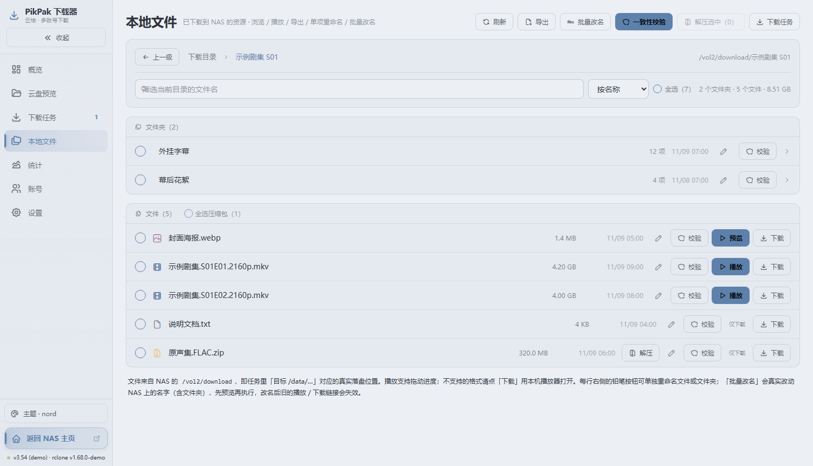
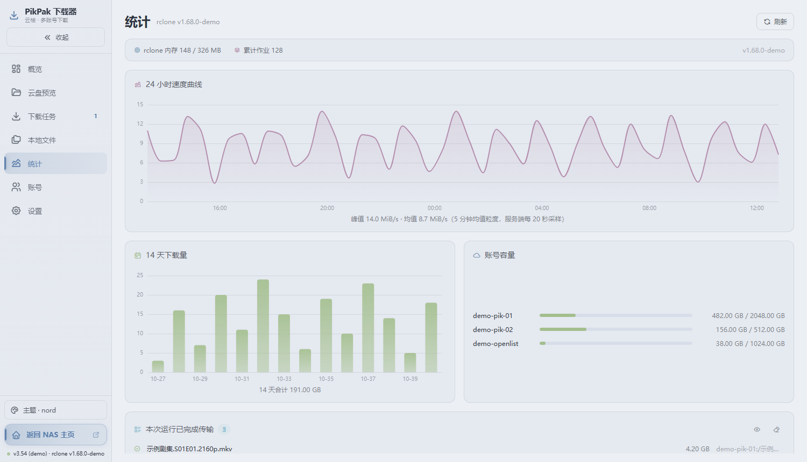
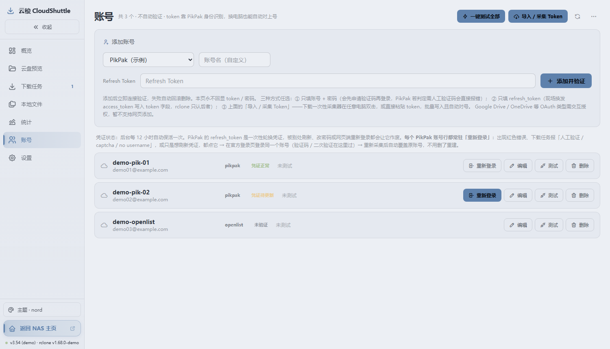
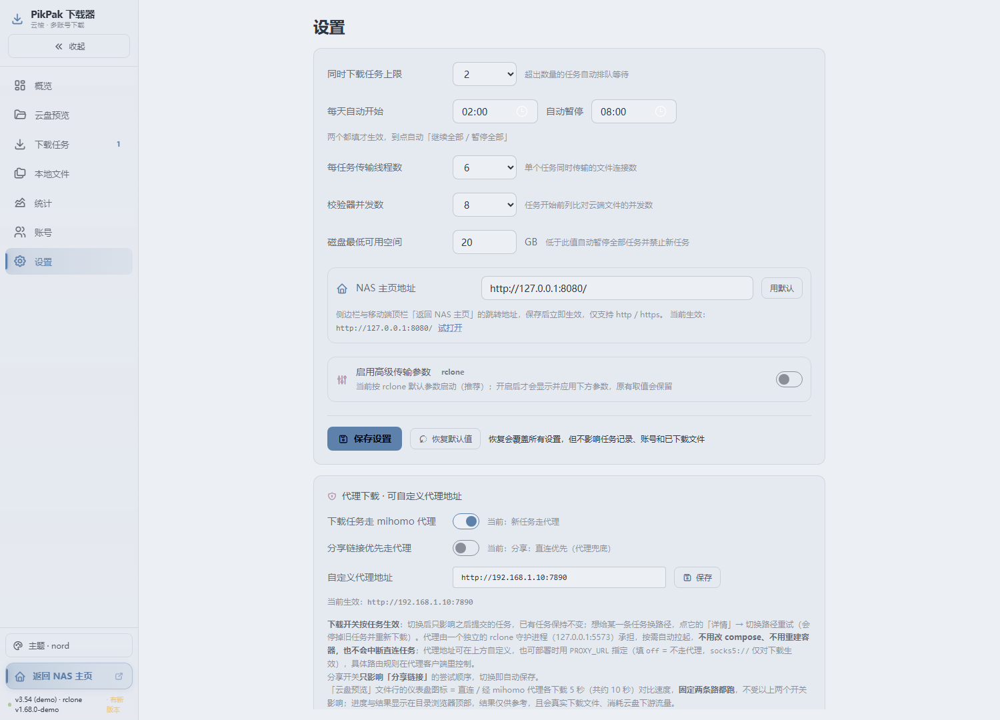
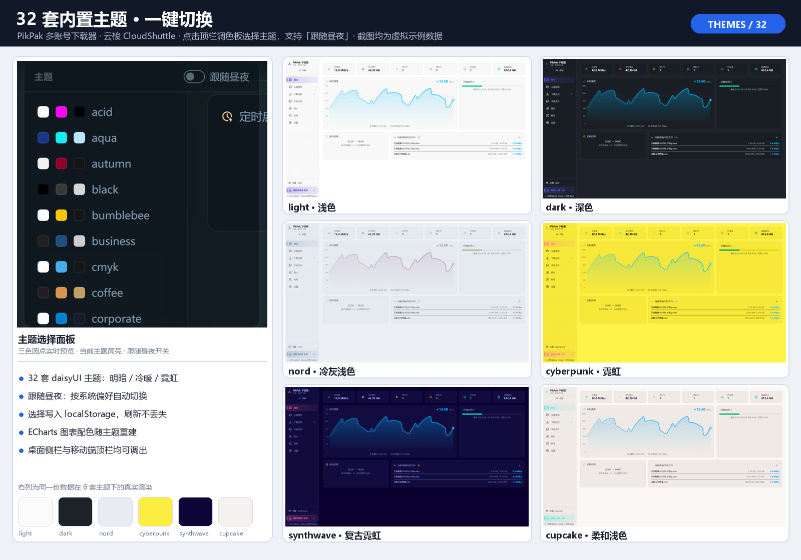
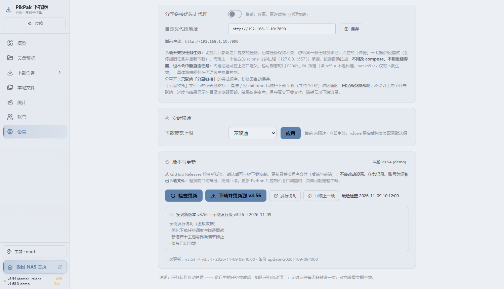
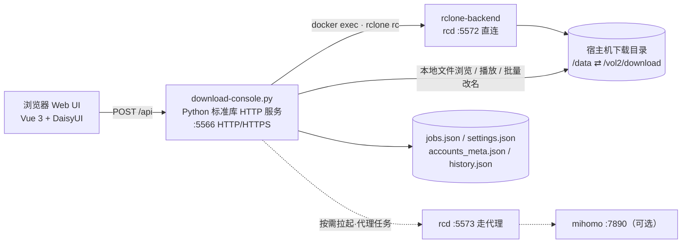

# PikPak 多账号下载器 · 云梭 CloudShuttle

> **PikPak 多账号下载器**，代号「云梭 CloudShuttle」：多个 PikPak 账号统一接入、批量下载到 NAS，一个页面管完账号凭证、下载任务、云盘目录与本地文件。

 [](https://github.com/Dlany-Cohhh/cloud-shuttle/releases)    

**当前版本 v3.55** · Python 3.10+ 标准库 · Vue 3 全局构建（无 npm 构建步骤）· MIT

仓库地址：**[github.com/Dlany-Cohhh/cloud-shuttle](https://github.com/Dlany-Cohhh/cloud-shuttle)**

**关键词**：PikPak 下载器 · PikPak 多账号 · PikPak 批量下载 · PikPak 网盘 · NAS 下载器 · rclone pikpak · pikpak downloader · multi-account downloader · 云梭 CloudShuttle · Docker 一键部署

> [!WARNING]
> 这是**内网自用的无鉴权工具**：Web 界面与 `/api` 都没有登录校验。请把 5566 端口限制在局域网内，不要直接暴露到公网；使用第三方网盘服务时请自行遵守其服务条款。详见 [SECURITY.md](SECURITY.md)。
>
> 本文所有界面截图均为**虚拟演示数据**：账号 `demo-*`、邮箱 `@example.com`、文件名「示例…」、速度与容量全部为构造值，页脚标注 `v3.54 (demo)`，不含任何真实账号或文件信息。

---

## 目录

- [它解决什么问题](#它解决什么问题)
- [界面一览：7 个导航栏](#界面一览7-个导航栏)
- [多主题切换](#多主题切换)
- [检查更新与一键升级](#检查更新与一键升级)
- [核心能力](#核心能力)
- [工作原理](#工作原理)
- [技术栈](#技术栈)
- [一键部署](#一键部署)
- [快速开始](#快速开始)
- [配置说明](#配置说明)
- [目录结构](#目录结构)
- [API 概览](#api-概览)
- [安全与隐私](#安全与隐私)
- [使用注意与常见问题](#使用注意与常见问题)
- [第三方组件](#第三方组件)
- [版本、变更与许可](#版本变更与许可)

---

## 它解决什么问题

这是一个给 **PikPak 多账号** 用的下载器：多个 PikPak 账号统一接入后，把资源批量搬到 NAS。真正麻烦的从来不是「下载」本身，而是账号多了要挨个试能不能连、夜里想排队白天想限速、下载完还得开文件管理器找文件改名校验、代理每次都要重配容器。

这个项目把这些环节收进一个单页控制台：

- **一个面板管所有账号**：凭证状态、容量、一键连接测试、Token 导入与续期；
- **下载是任务，不是命令**：并发上限、排队、暂停 / 续传 / 重试、定时启停、磁盘空间保护、逐任务选代理；
- **云端和本地都能浏览**：在线播放、批量重命名、回收站、本地解压、M3U / CSV 导出、一致性校验；
- **部署足够轻**：后端一个 Python 文件、前端不打包、依赖全自托管，Docker 起来就能用，断网也能打开界面。

设计取舍很明确：**内网优先、单机优先、零构建**。它没有登录、没有数据库、没有消息队列，配置和任务状态就是几个 JSON 文件；换来的是改一行 JS 刷新浏览器就能生效，出问题 `cat` 一下 JSON 就能定位。

---

## 界面一览：7 个导航栏

左侧导航共 7 项，下面逐页展示。**截图全部使用虚拟示例数据**（`nord` 主题），用于说明各页功能，不代表任何真实运行结果；多主题功能图见下一节。

### 1. 概览



六张统计卡给出总速度、本次累计、进行中 / 排队中 / 已完成数量与磁盘剩余；实时速度曲线带 60 秒均速参考线；下方是磁盘用量、定时启停时段和「当前传输中的文件」明细（可一键隐藏文件名）。这一页是日常挂着看进度的主视图。

### 2. 云盘预览



可搜索的账号下拉同时显示邮箱、凭证状态与今日配额；顶部配额条列出云下载 / 下行 / 上传 / 每日四档额度和会员状态；目录里文件夹与文件分开列，支持列表 / 缩略图双视图、勾选后批量下载、在线播放、对比测速、批量改名与查重导出。`copy`（保留云端）和 `move`（下完删云端）在这里切换，切换 `move` 会有二次确认。

### 3. 下载任务



任务卡显示进度条、百分比、已传 / 总量、速度、剩余时间、当前文件与目标目录，并按下载中 / 排队中 / 已暂停 / 出错 / 已完成分组筛选。支持整批暂停、继续、重试失败、清理已完成记录、删除记录，以及粘贴 HTTP(S) 直链直接下载到 NAS（不经过网盘）。

### 4. 本地文件



浏览已落盘到 NAS 的目录与文件，面包屑导航、名称筛选、按名称 / 大小 / 时间排序；可在线播放或下载到本机、导出 M3U 播放列表与 CSV 清单、对压缩包批量解压、做云端一致性校验，以及**批量改名**（模板 / 正则 / 序号，先预览再执行，整批预检、失败回滚）。

### 5. 统计



rclone 进程内存与累计作业健康条；24 小时速度曲线（5 分钟均值粒度）、14 天下载量柱状图、各账号容量占用，以及本次运行已完成传输记录（同样支持隐藏文件名）。

### 6. 账号



多账号集中管理：账号名 / 类型 / 邮箱、凭证状态徽标（正常 / 待更新 / 需重新登录 / 未验证）、单账号测试、编辑改名、删除、重新登录；顶部「一键测试全部」以 3 路并发逐个真连接并显示进度。导入方式包括粘贴 `refresh_token`、Windows 采集器、浏览器书签一键导入；v3.51 起还会识别并清理 rclone 残留的无效空壳配置段。

### 7. 设置



同时下载任务上限、每天自动开始 / 暂停时间、每任务传输线程数、校验器并发数、磁盘最低可用空间、高级 rclone 参数、限速与代理开关，以及可自定义的「NAS 主页地址」（侧边栏「返回 NAS 主页」用）。**自定义代理地址在页面往下滚后的「代理下载」卡片第三行**：输入框填 `http(s)://host:port`、`socks5://host:port` 或 `off`，点右侧「保存」，下方「当前生效」会回显实际地址。页面更底部的「版本与更新」卡片用来检查 GitHub 新版本并一键升级。所有设置持久化到 `settings.json`，源码 `DEFAULTS` 会自动补齐缺失字段。

---

## 多主题切换



内置 **32 套 daisyUI 主题**（明暗、冷暖、霓虹一应俱全）。点侧栏底部「主题 · 当前主题」或移动端顶栏的调色板图标打开选择面板，每套主题带三色预览圆点；勾选「跟随昼夜」会按系统偏好在 `nord` / `sunset` 之间自动切换。选择写入浏览器 `localStorage`，ECharts 图表配色也会随主题重建。上图左上为真实的主题选择面板，其余格子是**同一份虚拟示例数据在 6 套主题下的实际渲染**，不是示意图。

---

## 检查更新与一键升级

「设置 → 版本与更新」点「检查更新」，发现新版后一键下载升级；升级会校验发行包并自动备份，只替换程序文件，账号与任务数据不受影响，也可在同一卡片回滚上一版。



完整流程见 [docs/UPDATE.md](docs/UPDATE.md)。

---

## 核心能力

| 模块 | 能力 |
| --- | --- |
| 账号管理 | 多账号列表、导入 / 采集 Token、重新登录、编辑改名、单账号测试、**一键测试全部**（3 路并发 + 进度）、容量与凭证状态、清理残留配置段 |
| 下载任务 | 分享链接解析、批量建任务、启停 / 断点续传 / 重试、实时速度与进度、并发数与定时启停、磁盘空间保护、高级 rclone 参数、代理逐任务切换、任务详情与错误诊断 |
| 云盘浏览 | 目录浏览、在线播放、对比测速、一致性校验、批量重命名（模板 / 正则 / 序号，先预览再执行）、回收站、分享提取次数管理、查重与导出 |
| 本地文件 | 浏览 / 播放 / 下载、M3U 与 CSV 导出、批量解压、**批量重命名**（含文件夹，整批预检 + 失败回滚）、一致性校验 |
| 统计 | 实时速度、24 小时曲线、14 天下载量、账号容量、已完成传输、rclone 健康指标 |
| 下载扩展 | OpenList 聚合网盘、aria2 BT / 磁力、yt-dlp 视频站（均为可选服务） |
| 设置 | 传输参数、限速、日志、代理开关、**自定义代理地址**、NAS 主页地址等，全部持久化 |
| 界面与维护 | 32 套主题 + 跟随昼夜、侧栏折叠、版本与更新检查、一键下载升级 / 回滚、发行包校验与自动重启 |

几个实现上值得一提的点：

- **逐任务选代理**：rclone-backend 内跑两个 rcd（5572 直连 / 5573 经 mihomo 代理），任务可单独指定走哪条链路，不必重建容器。
- **Token 保活**：PikPak 的 `refresh_token` 单次轮换，谁刷新谁必须立刻落盘；控制台配合每小时的续期脚本，并识别 rclone 回写产生的无 `type` 空壳段。
- **批量改名是真实操作**：本地文件页改的是 NAS 上真实文件名，整批预检（越界路径、软链接、隐藏文件、`.part` 临时名、重名）后才两阶段改名，失败自动回滚；执行后弹窗保留、预览按新文件名刷新，可连续多轮操作。

---

## 工作原理



数据流很简单：页面每 2 秒轮询 `jobs` / `stats` 拿任务与速度；所有下载实际由 rclone 守护进程执行，控制台只负责下发 RC 命令、维护任务队列与落盘状态；本地文件相关操作直接由 Python 服务读写挂载目录。前端所有库都随仓库自托管，不请求任何 CDN。

---

## 技术栈

- **后端**：Python 3.10+ 标准库（`http.server` + `ThreadingHTTPServer`），单文件；同端口按 TLS 首字节自动区分 HTTP / HTTPS；无 pip 依赖。
- **下载引擎**：`rclone/rclone` 容器的 `rcd` + PikPak 后端，控制台通过 RC 接口下发任务。
- **前端**：Vue 3.5.44 全局构建 + `static/index.html` 里的 in-DOM 模板、`static/app.js` 组件逻辑；Tailwind CSS v4、daisyUI 5.7.50、Tabler Icons 3.50.0、Apache ECharts，全部自托管。
- **部署**：Docker Compose + host 网络；控制台镜像基于 `python:3.12-alpine`，额外安装 `docker-cli`。

保持单文件结构是有意为之：线上通过 volume 把整个目录挂到容器 `/app`，前端模板与 `collector.ps1` 的路径被写死，拆模块需要配套重构与回归测试。

---

## 一键部署

**Linux / macOS / NAS**（需先装好 Docker 与 Compose 插件）：

```bash
git clone https://github.com/Dlany-Cohhh/cloud-shuttle.git
cd cloud-shuttle
bash scripts/deploy.sh
```

**Windows**（Docker Desktop）：下载仓库后**双击 `scripts\deploy.bat`**，或在项目目录执行：

```powershell
powershell -ExecutionPolicy Bypass -File scripts\deploy.ps1
```

向导只问三件事：**下载保存目录**、**rclone 配置目录**、**代理地址**，然后自动完成：生成随机 RC 凭据 → 写 `.env` → 建空的 `rclone.conf` → 构建并启动容器 → 健康检查 → 打印访问地址。

代理地址可以自由选择：

| 选择 | 填什么 | 说明 |
| --- | --- | --- |
| 默认代理 | 直接回车 | Linux `http://127.0.0.1:7890`；Windows `http://host.docker.internal:7890` |
| 自定义地址 | `http(s)://host:port` 或 `socks5://host:port` | 任意代理客户端 / 旁路网关，不要求一定跑 mihomo 容器 |
| 不走代理 | `off` | 两条下载路径都直连 |

非交互用法：`bash scripts/deploy.sh --yes --proxy http://192.168.1.10:7890 --downloads /mnt/nas/downloads`；`--dry-run` 只生成配置不启动；`status | logs | stop | restart` 管理已部署的容器。Windows 对应 `-Yes -Proxy ... -DryRun -Command status`。

Linux 版用 host 网络（直接占用 5566）；Windows 版自动叠加 `docker-compose.windows.yml` 改成 bridge 端口映射，可用 `-Port` 改对外端口。两者都通过 `docker.sock` 让控制台指挥 rclone-backend，账号配置与下载数据全部留在宿主机目录，停掉容器不会丢数据。

部署后进「账号」页导入 PikPak 账号即可用。代理地址随时能在「设置 → 往下滚 → 代理下载卡片的『自定义代理地址』输入框」里改，优先级高于 `.env` 的 `PROXY_URL`，保存即生效；细节见 [docs/DEPLOYMENT.md](docs/DEPLOYMENT.md)。

---

## 快速开始

**想自己控制每一步就按本节配置；推荐直接用上一节的一键部署脚本。**

**前置条件**：一台能跑 Docker Compose 的 NAS / 主机、一个可用的 PikPak 账号、含 `type = pikpak` remote 的 `rclone.conf`。

```bash
# 0. 获取代码
git clone https://github.com/Dlany-Cohhh/cloud-shuttle.git
cd cloud-shuttle

# 1. 准备配置
cp .env.example .env
#    编辑 .env：填 PROJECT_ROOT / DOWNLOAD_ROOT / RCLONE_CONFIG_DIR，
#    并把 RCLONE_RC_USER / RCLONE_RC_PASS 改成自己的随机凭据

# 2. 把 rclone.conf 放到 RCLONE_CONFIG_DIR 指向的目录（格式见 docs/DEPLOYMENT.md）
#    注意：这个文件含 refresh_token，绝不要提交到仓库

# 3. 启动
docker compose -f docker-compose.example.yml up -d --build
```

浏览器打开 `http://<NAS 地址>:5566/`。首次使用建议先到「设置 → NAS 主页地址」把侧边栏「返回 NAS 主页」改成自己的导航页地址（默认示例值是 `http://127.0.0.1:8080/`）。

不用 Docker 也可以直接 `python3 download-console.py` 运行（需要本机可调用 `docker exec rclone-backend ...`）。详细步骤、可选服务与故障排查见 [docs/DEPLOYMENT.md](docs/DEPLOYMENT.md)。

---

## 配置说明

### 环境变量

| 变量 | 用于 | 说明 |
| --- | --- | --- |
| `RCLONE_RC_USER` / `RCLONE_RC_PASS` | 控制台 + rclone-backend | RC 接口凭据，两边必须一致；**仓库源码不含默认值** |
| `CONSOLE_DATA_DIR` | 控制台 | 运行时 JSON 的存放目录，默认与脚本同目录（容器内 `/app`） |
| `PROXY_URL` | 控制台 | 自定义代理地址（http(s)/socks5），`off` = 不走代理；设置页的值优先于它 |
| `WEB_PORT` | compose（Windows） | bridge 模式对外端口，默认 5566；Linux host 网络下固定 5566 |
| `CONSOLE_PUBLIC_HOST` | 控制台 | 生成 Windows 采集脚本时的兜底回推地址（默认 `localhost:5566`）；正常请求按 `Host` 头自动判断，反代场景可显式指定 |
| `RCLONE_CONF` / `TOKEN_LOG` | 续期脚本 | `rclone.conf` 路径与日志路径 |
| `PROJECT_ROOT` / `DOWNLOAD_ROOT` / `RCLONE_CONFIG_DIR` | compose | 挂载路径，见 `.env.example` |

### 设置文件

页面「设置」保存后生成 `settings.json`（已被 `.gitignore` 忽略）。完整字段见 [examples/settings.example.json](examples/settings.example.json)，首次启动会自动用源码里的 `DEFAULTS` 补齐缺失项。

### 账号与 Token

账号信息只存在 `rclone.conf` 里，控制台不保存密码。导入方式：

- 账号页「导入 / 采集 Token」：粘贴 `账号名 + refresh_token`，或旧面板导出的 JSON；
- 「重新登录」：下载控制台现场生成的 `login-collector.ps1`，在 Windows 上跑一次即可；
- 「一键导入」书签：`static/bm.html` + `bm-code.js`，在 PikPak 网页登录后点书签回传。

`refresh_token` 是**单次轮换**的：谁刷新谁必须立刻落盘。生产环境建议用 cron 每小时跑一次 `scripts/refresh-pikpak-token.sh`，否则长时间不下任务后 token 可能过期。

---

## 目录结构

```
.
├── download-console.py          # 后端：HTTP 服务、任务调度、rclone RC 调用（单文件）
├── collector.ps1                # Windows 端 Token 采集器模板（由控制台现场生成下发）
├── login-collector.ps1          # Windows 端干净浏览器登录采集器模板
├── static/
│   ├── index.html               # Vue in-DOM 模板（整个单页界面）
│   ├── app.js  app.css          # 组件逻辑与样式
│   ├── bm.html  bm-code.js      # 「PikPak 一键导入」书签工具
│   ├── tabler/                  # Tabler Icons 字体与 CSS
│   └── *.js / *.css             # 自托管的 Vue / Tailwind / daisyUI / ECharts
├── docs/
│   ├── screenshots/             # 本文使用的 9 张界面截图（全部为虚拟示例数据）
│   ├── DEPLOYMENT.md            # 详细部署、账号配置与故障排查
│   ├── UPDATE.md                # 在线检查更新、发版与回滚
│   ├── release-workflow.yml     # 可选的 CI 模板（复制到 .github/workflows/ 启用）
│   └── API.md                   # 接口速查与全部 action 清单
├── scripts/
│   ├── build_release.py         # 构建发行包 cloud-shuttle.zip + sha256
│   ├── publish_release.py       # 本地一键构建并发布 Release（不依赖 CI）
│   ├── deploy.sh  deploy.ps1  deploy.bat   # Linux / Windows Docker 一键部署
│   └── refresh-pikpak-token.sh  # PikPak refresh_token 定时续期（建议每小时）
├── examples/
│   └── settings.example.json    # 完整设置示例（由源码 DEFAULTS 生成）
├── Dockerfile                   # python:3.12-alpine + docker-cli
├── docker-compose.example.yml   # 脱敏后的最小可运行编排
├── docker-compose.windows.yml   # Windows Docker Desktop：bridge + 端口映射覆盖
├── .env.example                 # 需要自己填的路径与凭据
└── .gitignore / .gitattributes / .dockerignore / .editorconfig
```

---

## API 概览

后端只暴露一个入口：`POST /api`，请求体带 `action` 字段，返回 JSON。前端的 `api(action, body)` 统一封装了超时与错误处理。

```bash
# 任务与状态
curl -s http://localhost:5566/api -H 'Content-Type: application/json' \
  -d '{"action":"jobs"}'

# 列出某账号根目录
curl -s http://localhost:5566/api -H 'Content-Type: application/json' \
  -d '{"action":"dirs","remote":"demo-pik-01","path":""}'

# 列出账号
curl -s http://localhost:5566/api -H 'Content-Type: application/json' \
  -d '{"action":"accounts"}'
```

共 65 个 `action`，覆盖账号、任务、云盘、本地文件、统计、设置、分享、解压与在线更新等，完整清单与参数见 [docs/API.md](docs/API.md)。更新相关的 4 个 action 是 `updatecheck` / `updateapply` / `updatestate` / `updaterollback`：

```bash
# 检查最新版本（force=true 跳过 10 分钟缓存）
curl -s http://localhost:5566/api -H 'Content-Type: application/json' \
  -d '{"action":"updatecheck","force":true}'
```

**该接口没有鉴权**，仅限内网调用。

---

## 安全与隐私

- **不要提交**：`rclone.conf`、`settings.json`、`accounts_meta.json`、`jobs.json`、`history.json`、`tls/*.pem`、`.env`、任何 `*.bak*` 备份、私有运维笔记。`.gitignore` 已覆盖。
- **无鉴权**：请不要把 5566 端口映射到公网；需要外网访问请自行加反向代理 + 认证。
- **HTTPS**：在项目目录放 `tls/cert.pem` + `tls/key.pem`（自签即可）后，同一端口会同时提供 HTTPS，用于浏览器在安全上下文里播放在线视频。
- **报错脱敏**：后端 `mask_secret()` 会把超长 token / `os.` 开头的 refresh_token 打码后再回显，避免凭证出现在页面或日志里。
- **演示截图**：`docs/screenshots/` 里的图片由本地 mock 数据渲染，账号、邮箱、文件名、容量、速度均为构造值。
- **一键部署产物**：脚本生成的 `.env`（含随机 RC 密码）与 `rclone.conf`（含 refresh_token）都在仓库目录里，已被 `.gitignore` 忽略，不要提交或转发。
- **在线更新**：校验与白名单规则见 [docs/UPDATE.md](docs/UPDATE.md)；更新状态 `update-state.json` 与备份 `update-backups/` 已被 `.gitignore` 忽略。

更多说明见 [SECURITY.md](SECURITY.md)。

---

## 使用注意与常见问题

| 情况 | 说明 |
| --- | --- |
| 页面改了但没生效 | 静态资源（`static/app.js` / `index.html`）刷新浏览器即可，必要时 Ctrl+F5；Python 改动需重启容器，重启前确认没有 running 任务 |
| `move · 下完删云端` | 下载完成后会删除云端源文件，不可恢复；默认且推荐的是 `copy · 保留云端` |
| 本地「批量改名」 | 改的是 NAS 上真实文件名，旧播放 / 下载 / 外链地址会失效；执行后弹窗保留，预览按新名字刷新 |
| 账号显示红字 / 旧名复活 | rclone 的 `captcha_token` 回写会留下无 `type` 的空壳配置段；v3.51 起列表自动忽略，并可在「更多」里一键清理 |
| 任务莫名变慢 | 检查设置里的并发数、限速、`downloadProxy` 以及非会员每日下行额度是否已用尽 |
| 换了代理地址暂时没生效 | 5573 守护进程仍用旧地址，且可能有代理任务在跑 | 等任务结束或重启 `rclone-backend`；设置页会提示生效时机，也可在 `.env` 里改 `PROXY_URL` |
| 两个 rcd 的配置不一致 | 5572 / 5573 各持一份内存配置，清理残留段时会两边一起处理 |

---

## 第三方组件

| 组件 | 版本 | 许可证 |
| --- | --- | --- |
| Vue.js | 3.5.44 | MIT |
| daisyUI | 5.7.50 | MIT |
| Tabler Icons | 3.50.0 | MIT（见 `static/tabler/tabler-icons.min.css` 文件头） |
| Tailwind CSS | v4 浏览器构建 | MIT |
| Apache ECharts | 见文件头 | Apache-2.0 |
| rclone | 镜像 `rclone/rclone:latest` | MIT |

这些文件原样放在 `static/` 下以便离线运行，未做修改。

---

## 版本、变更与许可

版本历史见 [CHANGELOG.md](CHANGELOG.md)；页脚显示的版本号来自 `download-console.py` 的 `APP_VERSION`，可用来确认线上是否加载了新代码。

[MIT](LICENSE) · 仅供学习与个人自用，使用前请自行评估第三方服务条款。
